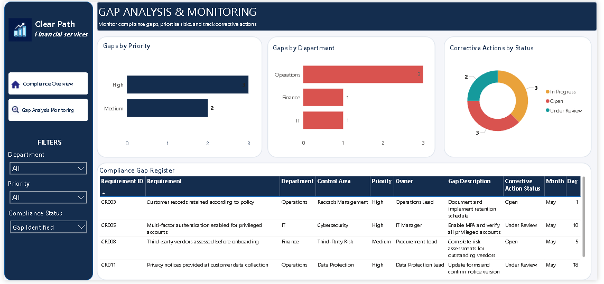

# Compliance Gap Analysis & Monitoring Dashboard

**Project Type:** Data Analytics | Power BI | Compliance Monitoring  
**Tools:** Power BI Desktop · Power Query · DAX · Microsoft Excel  
**Industry:** Financial Services (Fictional Scenario)

---

## Project Overview

This project demonstrates how Power BI can be used to monitor compliance requirements, identify gaps, and track corrective actions across departments.

The dashboard was developed using a fictional financial services company, **ClearPath Financial Services Ltd.**, to demonstrate practical data analysis, data modelling, DAX, and dashboard design skills.

> ⚠️ **Disclaimer:** The company and all records used in this project are fictional. The dataset is synthetic and is intended for portfolio demonstration purposes only.

---

## Business Problem

Organisations need a clear way to monitor compliance requirements, identify gaps, prioritise issues, and follow up on corrective actions.

When this information is difficult to review, management may struggle to identify areas requiring attention or track the progress of corrective actions.

This project brings the information together in an interactive Power BI dashboard.

---

## Project Objectives

- Monitor compliance requirements and their status
- Identify gaps across departments
- Compare identified gaps by priority
- Track corrective actions by status
- Allow users to explore the data through interactive filters
- Present findings that can support management review and follow-up

---

## Tools Used

| Tool | Purpose |
|---|---|
| Microsoft Power BI Desktop | Dashboard development and data modelling |
| Power Query | Data import and transformation |
| DAX | KPI calculations and measures |
| Microsoft Excel | Source dataset storage |

---

## Dashboard Pages

### Page 1: Compliance Overview

This page provides a summary of compliance performance through KPI cards, charts, and interactive slicers.

**Includes:**
- Total Requirements
- Compliant Requirements
- Identified Gaps
- In Progress
- Compliance Rate
- Compliance Status Breakdown
- Compliance Requirements by Department

---

### Page 2: Gap Analysis & Monitoring

This page provides a more detailed view of identified gaps and corrective actions.

**Includes:**
- Gaps by Priority
- Gaps by Department
- Corrective Actions by Status
- Compliance Gap Register
- Department, Priority, and Compliance Status filters

> **Note:** The report's interactions are configured so that the Compliance Status slicer does not filter the Corrective Actions by Status chart.

---

## Dataset

The Excel workbook contains two main tables:

**Compliance Requirements**  
Contains requirement details, department, control area, compliance status, priority, owner, review dates, evidence notes, and gap descriptions.

**Corrective Actions**  
Contains corrective action details, linked requirement IDs, action owners, action statuses, target dates, and notes.

The two tables are linked through **Requirement ID**.

---

## Key Results

| Metric | Result |
|---|---|
| Total Requirements | 20 |
| Compliant Requirements | 12 |
| Identified Gaps | 5 |
| Requirements In Progress | 3 |
| **Compliance Rate** | **60.0%** |
| **Gap Rate** | **25.0%** |
| Total Corrective Actions | 8 |

> These figures describe the sample dataset only. They do not represent the performance of a real organisation.

---

## Skills Demonstrated

- Data preparation and transformation
- Data modelling and table relationships
- DAX measures and KPI calculations
- Interactive Power BI dashboards
- Visual-level filters and slicer interactions
- Compliance monitoring and gap analysis
- Data visualisation
- Business reporting and recommendations

---

## Limitations

- This is a portfolio demonstration using **synthetic data**. It has not been validated against a real organisation's policies, regulatory obligations, or evidence records.
- The dashboard supports monitoring and analysis. It does not replace a formal audit, legal advice, or professional compliance judgement.

---

## Author

**Oluwatoyin Praise Oloruntoba**  
Data Analyst | AI Governance & Compliance | Executive Virtual Assistant  
📍 Lagos, Nigeria · Open to Remote Roles

[LinkedIn](https://www.linkedin.com/in/oluwatoyin-oloruntoba-779873388) · [Portfolio](https://app.notion.com/p/Compliance-Gap-Analysis-Monitoring-Dashboard-403cd905012f81d39317ce882279a6a2?source=copy_link)
